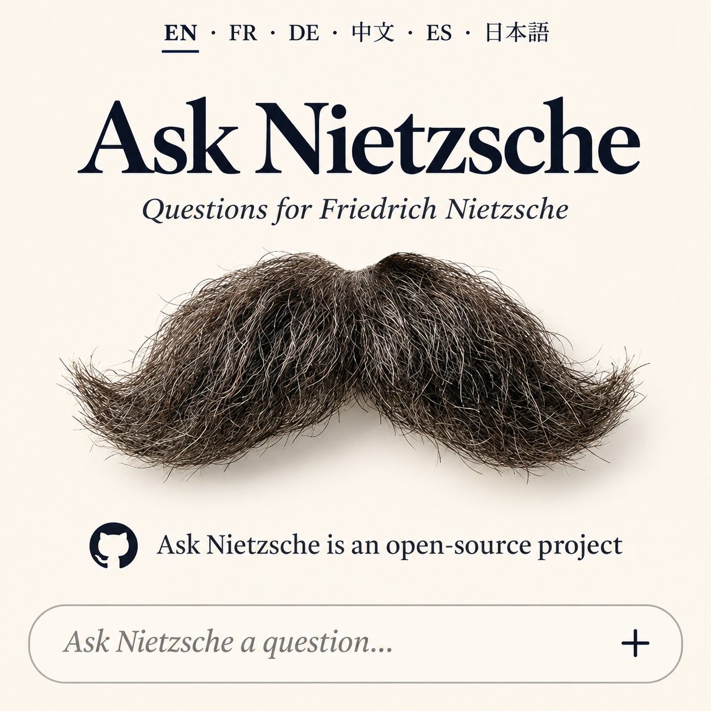

# Ask Nietzsche

Ask Nietzsche is an open-source conversational project that stages a dialogue with Friedrich Nietzsche through a language model, a set of character instructions, a retrieval corpus, and an evolving bank of response patterns.

> This is a literary and interpretive experiment. It is not Nietzsche, does not reproduce his consciousness, and must not be treated as an authoritative source on his views.

## What is included

- Six localized web clients (English, French, German, Spanish, Japanese, and Chinese).
- PHP API code for model requests, attachments, retrieval, pattern selection, and account/session features.
- The current SQLite retrieval database and the Project Gutenberg text files from which it was assembled.
- English project, prompt, retrieval, pattern-bank, privacy, and deployment documentation.
- A square English mobile landing-page announcement visual in `assets/ask-nietzsche-mobile-splash-en.png`.

## Current retrieval corpus

The bundled database contains 5,180 passages from 15 selected works or editions, in German, English, and French. It is a curated subset, not Nietzsche's complete works. The current retrieval uses SQLite FTS5 full-text search with BM25 ranking after keyword extraction; it is not an embedding-based vector search. Some works are translations, and *The Will to Power* file is a posthumous selection edited by Max Brahn, not a book Nietzsche published in that form.

See [`docs/RAG.md`](docs/RAG.md) and [`DATA-LICENSES.md`](DATA-LICENSES.md) before redistributing or deploying the corpus.

## Run locally

The browser client is static HTML. The API requires PHP with cURL, PDO/MySQL, SQLite support, and an Anthropic API key. Copy `api/db-config.example.php` to `api/db-config.php`, configure the database, and set the Anthropic key through a server-side environment variable or a secret file outside the web root. Never put credentials in the repository or browser code.

Configure the web server to serve this directory, enable the required PHP extensions, create the MySQL tables expected by `api/user.php` and `api/log-conversation.php`, and set up the RAG database path used by `api/chat.php`. Review [`docs/DEPLOYMENT.md`](docs/DEPLOYMENT.md) before exposing an instance publicly.

## Product access and privacy limitations

The project owner's stated product rule is: **dialogues and answers are public; private access requires purchased credits.** This rule must be made clear to users before they submit sensitive material.

The source snapshot in this repository does not yet implement a purchase flow or enforce a private-session/credit boundary. It does contain server-side conversation logging to MySQL. The repository snapshot has no public transcript gallery; public visibility is therefore an intended product policy, not a verified feature of this code snapshot. Before claiming private sessions, implement and review access control, billing, retention, deletion, and a clear distinction between public and private records.

Other current limitations:

- The corpus covers only 15 selected works/editions and has uneven language coverage.
- Retrieval quality depends on keyword extraction and lexical matches; related passages can be missed.
- The pattern bank is experimental. `P-JGB-001` is the documented active pattern; other ideas remain candidates.
- The character is a model-generated interpretation. It can invent, misattribute, or flatten disagreements across Nietzsche's works.
- The API depends on Anthropic availability, credentials, pricing, and service rules.
- Attachments are processed for a request and are not meant to be retained as a server-side archive; verify the deployed implementation and hosting logs before making privacy guarantees.

## License

The application code is offered under the MIT License. The Nietzsche corpus has separate source and Project Gutenberg terms; see [`DATA-LICENSES.md`](DATA-LICENSES.md). Do not assume the code license applies to bundled texts.

## Project status

This repository is an extracted public edition of a live project. Remove local deployment settings, analytics identifiers, and secrets before reuse. Features described as planned or experimental are not guaranteed to be active on the hosted website.
